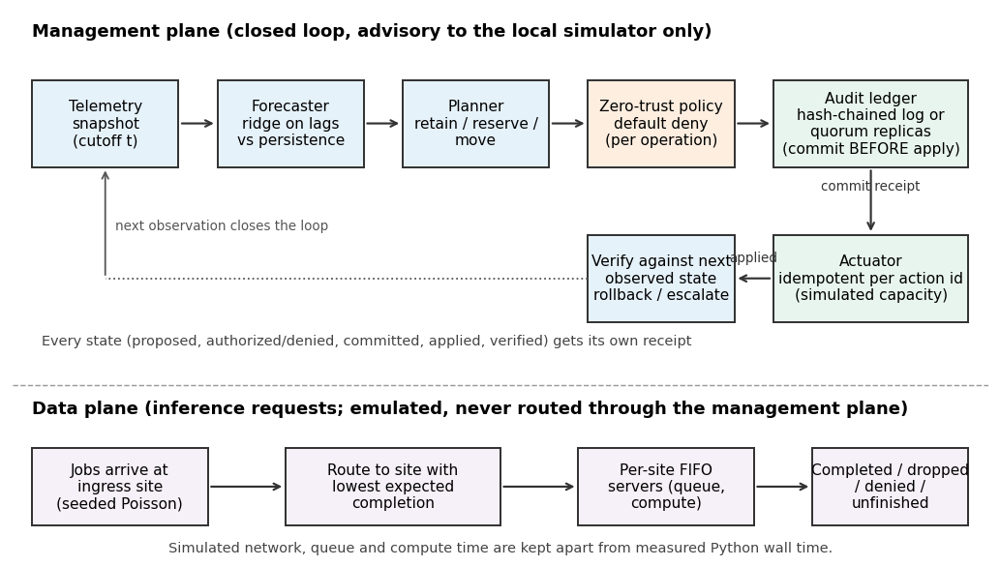

# ss-zt6g-edge-ai

An independent, **offline** Python research companion to

> Mahin MRH, Chakraborty P, Das N, Kaur H, Himel HU, Kaur J, Mohapatra AG. *Secured and Standardized Intelligent Zero-Touch 6G Framework for Edge-AI Applications.* IEEE Communications Standards Magazine, 2026, pp. 1-5. DOI [10.1109/MCOMSTD.2026.3660159](https://doi.org/10.1109/MCOMSTD.2026.3660159) (IEEE Early Access, Xplore document 11411876; no volume or issue assigned yet).

> **Read this first.** The paper is a short simulation study. It releases no code, data, labels or splits, and it does not define its latency endpoints, comparator architectures, efficiency denominator or detection ground truth. **This repository does not reproduce the paper's results and says so on every number.** It answers a narrower question with software you can run:
>
> *When demand rises at an edge site, what does the orchestrator predict, which action does it propose, who authorizes it, what changes in the simulated service, and what evidence lets you audit the decision?*
>
> Then it uses the same software to compare reproducible baselines (fixed placement, threshold-reactive, predictive) and reports unfavourable results too. Everything is a local simulator: no carrier, radio unit, cloud control plane or device is contacted.

Maintainer and code owner: Partha Chakraborty ([@parthachk64-cyber](https://github.com/parthachk64-cyber)). See [Attribution](#attribution).

## Quick start

```bash
python -m venv .venv && . .venv/bin/activate      # Windows: .venv\Scripts\activate
pip install -e ".[dev]"                            # Python >= 3.10, CPU only
sszt6g demo                                        # about 4 minutes: train, walk one decision, benchmark, plot, write docs/results.md
pytest --cov=sszt6g
```

`sszt6g demo --smoke` uses two seeds instead of eight and finishes in about a minute. Without installing: `PYTHONPATH=src python -m sszt6g.cli demo`.

| Command | What it does |
|---|---|
| `sszt6g demo` | trains the forecaster, runs the three-case decision walkthrough, benchmarks, plots, writes `runs/demo/` and `docs/` |
| `sszt6g data-check --kind arrivals --path FILE` | validates a file against the import contract |
| `sszt6g train --out m.joblib` | fits the demand forecaster on earlier scenarios only |
| `sszt6g replay --arrivals FILE --planner predictive --model m.joblib` | replays recorded arrivals through one planner |
| `sszt6g benchmark` / `sszt6g compare` | paired-seed planner comparison and overhead ablations |
| `sszt6g verify-ledger --path LOG --checkpoint CP` | verifies a tamper-evident audit log against its signed checkpoint (`--quorum-dir DIR` for the replicated profile) |
| `sszt6g report --run runs/demo` | regenerates figures and `docs/results.md` from a run directory |
| `sszt6g build-fixtures` | regenerates the bundled synthetic fixtures and the dataset registry |

## One decision, end to end

Real output of `sszt6g demo` (full trace in [docs/trace-example.md](docs/trace-example.md); all times are simulated milliseconds, inference is emulated):

* **Snapshot at the decision.** Cutoff 55,000 ms, 44 telemetry records, none stamped after the cutoff. Demand at edge-east per 5 s interval: `[30, 37, 20, 31, 59, 99]`.
* **Prediction.** Ridge forecaster: 95.8 jobs in the next interval; persistence would say 99.
* **Plan.** Reserve 2 servers at edge-east (estimated utilisation 1.16, need 4, have 2).
* **Policy check.** Every operation is evaluated, default deny: issuer, signature, claim expiry, policy revision, tenant, posture, operation, resource, quota. Allowed.
* **Ledger.** Five receipts, one per state: `proposed` → `authorized` → `committed` (written **before** capacity changes) → `applied` → `verified`.
* **Service change.** Active at 59,000 ms, verified against the next observed state at 60,000 ms.

Two more cases run on the same code: capacity is free but tenant policy denies a `move` (capacity unchanged, ledger holds only `proposed`, `denied`); and a crash lands between the commit receipt and the apply, the process restarts, recovery applies the change once, and a duplicate delivery of the same intent changes nothing.



## Headline numbers: source, definition, comparator

Full ledger with denominators: [docs/results.md](docs/results.md). Three origins are never mixed: **PAPER** (printed in the article, not reproduced), **COMPANION-RUN** (this repo, seeded synthetic workloads, simulated time), **HARDWARE** (Python wall clock, overhead table only).

| Paper headline | Paper (source) | Companion definition | Companion value | Status |
|---|---|---|---|---|
| 44.9% lower latency | Abstract and Conclusion. Reproduces from (6.9 - 3.8) / 6.9, i.e. a **median** against a **mean**; Table 1 prints 53.6% against different values. Endpoints and comparators unstated. | completion minus arrival, comparable completed jobs, baseline named | predictive vs reactive **-11.9%** of mean (worse; CI [-35.8, 0.0]); predictive vs fixed placement **87.1%** (fixed drops 9.3% of jobs); `ramp_burst`, 8 paired seeds | paper: not reproducible. companion: executed |
| 9.8% higher automation efficiency | Abstract and Conclusion; 94.7 in text. Relative vs points and the baseline are unstated. | unique policy-eligible intents verified in SLA / all unique eligible intents | fixed 47.9% (23/48), reactive 66.7% (32/48), predictive 64.6% (31/48); predictive vs reactive -3.1% relative, -2.1 pp | paper: definition unknown. companion: executed |
| 97.5% detection accuracy | Abstract; vs AO6G 89.1, BEA 73.3. No sample size, class balance, ground truth or split. | (TP+TN)/N on held-out synthetic episodes, threshold chosen on development data | n = 453, prevalence 17.9%: always-benign 82.1%, policy denial 82.6%, logistic model **89.9%**, rules 92.7% | paper: not reproducible. companion: executed, **not tuned toward 97.5%** |

Honest reading: in these scenarios the forecaster is within noise of persistence (held-out MAE 10.9 vs 10.7), so the predictive planner does **not** beat the reactive one, and both beat fixed placement by a wide margin because fixed placement drops and delays jobs. A system can look faster by dropping slow jobs, which is why drop rate, completion rate and deadline misses sit beside every latency figure.

## Metric definitions

* **Latency** = job completion minus arrival, simulated (network + queue + compute kept separate in per-job records). **Reduction** = 100 x (baseline - proposed) / baseline on jobs completed in both arms, baseline named and positive; zero baselines return `None`.
* **Intent-to-verified-provisioning time** = verification time minus intent submission, simulated. Quantised by the 5 s control tick.
* **Automation rate** = unique policy-eligible intents verified automatically within SLA (20 s) / unique policy-eligible intents. Eligibility is computed from static policy before any controller runs. Duplicates count once; denials, rollbacks, escalations and capacity failures are counted separately. Relative increase and percentage-point change are both reported.
* **Detection accuracy** = (TP+TN)/N with the full confusion matrix, prevalence, precision, recall, F1, a Wilson interval, and an always-benign comparator.

## Architecture and modules

| Module | Role |
|---|---|
| `workload`, `simulator` | sites, tenants, quotas, seeded arrivals, queues, deadlines, provisioning and migration delay; accepted / dropped / denied / unfinished accounting; idempotent, capacity-conserving `Cluster` |
| `telemetry`, `prediction` | timestamped history with an explicit cutoff; ridge forecaster on lagged counts and queue depth vs persistence; empty history raises |
| `planners`, `orchestrator` | fixed, reactive, predictive planners; observe → predict → plan → authorize → apply → verify; SQLite state, stable action ids, cooldown, expiry, rollback and escalation, crash recovery |
| `trust`, `detection` | per-operation zero-trust decisions (default deny); rule and logistic detectors scored separately from authorization |
| `ledger` | tamper-evident audit log with signed checkpoint, and a 3-of-4 local quorum profile |
| `interfaces`, `standards` | versioned local contracts; standards registry |
| `experiments`, `metrics`, `plots`, `report`, `cli` | paired-seed experiments, metric functions, figures, results ledger, commands |

**Ledger honesty.** `AuditLog` is a *tamper-evident audit log*: hash-linked entries plus an Ed25519-signed checkpoint kept separately; it detects alteration, reordering and truncation up to the checkpoint. `QuorumLedger` is a *local replicated* ledger: four validators with independent Ed25519 keys and their own chains, a block commits at 3 distinct signed votes. A quorum receipt establishes that at least three configured validator keys signed that block hash at that height over its predecessor. It is crash-fault tolerant inside one process; it is **not** Byzantine fault tolerant, uses no network, and is **not** the paper's Hyperledger Fabric deployment.

## Standards

[docs/standards-map.md](docs/standards-map.md) maps behaviours to clauses of **ETSI GS ZSM 009-1 V1.1.1**, **ETSI GS ZSM 002 V1.1.1** and **3GPP TS 28.533 V18.2.0 (Rel-18)**, read from the specification text. It distinguishes conceptual mapping, local contract test, and interoperability against an independent implementation; **the last has not been done for any row**. NFV-MANO and O-RAN (SMO/O1) are listed as not implemented. Nothing here is called compliant.

## Data

[docs/data.md](docs/data.md) and [datasets/registry.json](datasets/registry.json). The paper's data is unidentified; bundled fixtures are synthetic and seeded; `data-check` validates authorized, de-identified telemetry you bring. No label, scenario name or outcome is a detector input.

## Replace the predictor, load data, pick a baseline, verify a receipt

```python
# 1. predictor: any object with model_id and predict_count(history, queue_per_server)  -> examples/custom_predictor.py
from examples.custom_predictor import EwmaTrend
from sszt6g.config import build_world
from sszt6g.experiments import run_arm
from sszt6g.workload import make_scenario

world = build_world()
run = run_arm(world, make_scenario("ramp_burst", 1001, world.topo), "predictive", EwmaTrend())   # 3. baseline: "fixed" | "reactive" | "predictive"
```

```bash
sszt6g data-check --kind arrivals --path examples/fixtures/arrivals_ramp_burst_seed1001.csv       # 2. load data
sszt6g replay --arrivals examples/fixtures/arrivals_ramp_burst_seed1001.csv --planner reactive
sszt6g verify-ledger --path runs/demo/audit/<run>.audit.jsonl --checkpoint runs/demo/audit/<run>.checkpoint.json   # 4. verify
```

## Limitations

* Synthetic, seeded, simulated. Scenario magnitudes were chosen by the implementer. Nothing certifies field performance.
* The forecaster, planners, ledger parameters, SLA and fault rate are companion choices, not paper specifications.
* Scale-up only (no release); cost is reported as server-seconds.
* The simulator is two sites with a single FIFO queue per site; inference is emulated, not executed.
* Skipped or not exercised: GPU or non-CPU execution (none needed), real hardware, any network, any independent standards implementation.

## Attribution

Maintainer and sole `CODEOWNER` of this repository: Partha Chakraborty. The article's complete byline is preserved in `CITATION.cff` (preferred citation). The supplied article PDF has no author-contribution statement, so this repository claims no specific authorship role for any author in the article; the software here is a separate, independent work. Publisher figures and the PDF are not included; the architecture diagram is an original drawing.

## Licence

MIT ([LICENSE](LICENSE)). Standards documents are not redistributed.
